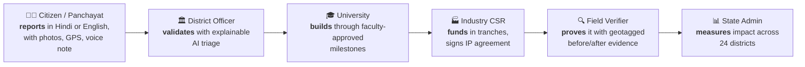
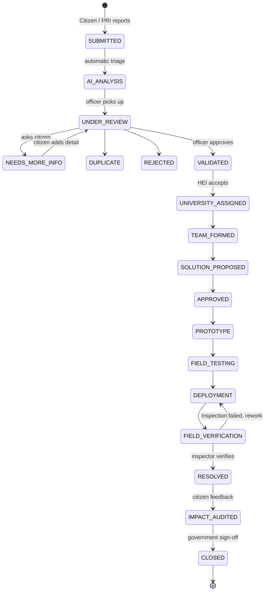
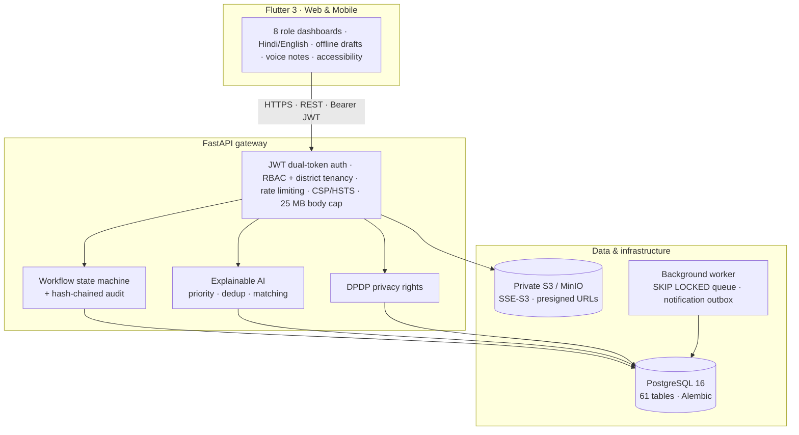

<div align="center">

<sub>GOVERNMENT OF JHARKHAND · DEPARTMENT OF HIGHER & TECHNICAL EDUCATION · SMART INDIA HACKATHON 2026 · PS 26043</sub>

# Jharkhand Societal Innovation & Collaboration Platform

### A village reports a broken hand pump. A university builds the fix. A CSR partner funds it. A field inspector proves it works.<br/>One platform runs that whole journey, across all 24 districts, with a human signing off every step.

[](https://github.com/kirancodes-dev/Jk/actions/workflows/ci.yml)
[](tests/)
[](frontend/test/)
[](ai_accuracy_report.json)
[](https://fastapi.tiangolo.com)
[](https://flutter.dev)
[](https://www.postgresql.org)

**[Live demo](https://prerighteous-shante-unctuous.ngrok-free.dev)** · **[API docs](https://prerighteous-shante-unctuous.ngrok-free.dev/docs)** · **[Try it in 5 minutes](#-try-it-in-5-minutes)** · **[Team testing guide (PDF)](docs/JK_Portal_Team_Testing_Guide.pdf)** · **[Traceability matrix](TRACEABILITY_MATRIX.md)**

</div>

---

## The problem, and our answer

> *"Develop a digital platform to crowdsource societal challenges from citizens and rural communities, and facilitate collaborative, milestone-driven problem solving through Higher Educational Institutions (HEIs) and industry CSR partnerships."* (SIH 26043)

Grievance portals collect complaints, but they end at "forwarded to department". Nobody builds the solution, and nobody proves it worked.

This platform treats every citizen report as an **R&D project with a finish line**:



---

## By the numbers

| 24 | 11 | 8 | 15 | 179 | 61 |
| :---: | :---: | :---: | :---: | :---: | :---: |
| districts, each with GIS boundary checks | challenge domains in a fixed taxonomy | stakeholder personas, each with its own dashboard | lifecycle stages, none skippable | REST API endpoints | database tables, 14 versioned migrations |

---

## ⚡ Try it in 5 minutes

**1. Open the [live demo](https://prerighteous-shante-unctuous.ngrok-free.dev)** (if ngrok shows a warning page, click *Visit Site*), or run it locally:

```bash
git clone https://github.com/kirancodes-dev/Jk.git && cd Jk
docker compose -f docker-compose.dev.yml up -d --build        # http://localhost:8008
docker compose -f docker-compose.dev.yml exec web python -m backend.app.services.seed_flagship_demo   # adds officer, verifier and PRI accounts
```

**2. Log in.** Every demo account uses the password **`password123`**:

| Persona | Email | What to look at |
| :--- | :--- | :--- |
| 🧑‍🌾 Citizen | `citizen@jharkhand.gov.in` | Report a challenge, see the AI analysis, track it to closure |
| 🏡 Gram Panchayat (PRI) | `pri.angara@jharkhand.gov.in` | Report on behalf of a village |
| 🏛️ District Officer, Ranchi | `officer.ranchi@jharkhand.gov.in` | Review queue scoped to Ranchi only; override the AI |
| 🔍 Field Verifier | `verifier.ranchi@jharkhand.gov.in` | Geotagged inspections and lab test results |
| 🎓 University (BIT Mesra) | `university@bitmesra.ac.in` | Accept assignments, create projects |
| 👩‍🏫 Faculty Mentor | `faculty@bitmesra.ac.in` | Approve milestones or request revisions |
| 👨‍💻 Student | `student@bitmesra.ac.in` | Tasks and deliverable uploads |
| 🏭 Industry CSR (Tata Steel) | `industry@tatasteel.com` | Fund projects, sign IP consent |
| 📊 State Admin | `admin@jharkhand.gov.in` | Statewide analytics, district heatmap, impact dashboard |

**3. Follow one challenge end to end:**

1. As **Citizen**, report *"Hand pump broken in Angara village"* with a photo. The AI suggests a domain, a priority and possible duplicates, and shows its reasoning.
2. As **District Officer**, change the AI's category. The override and your written reason go into a tamper-evident ledger. Then validate the challenge.
3. As **University**, accept the assignment and create a project with a milestone. As **Student**, submit a deliverable.
4. As **Faculty**, approve the milestone. As **Industry**, pledge a funding tranche.
5. As **Citizen**, open *Track Solution* and see every step, with who did it and when.

**Then try to break it:** open a Dhanbad challenge as the Ranchi officer, paste an admin URL as a citizen, or upload a disguised `.exe`. Each attempt is refused.

The full test plan (60+ checks across every role, device and language) is in the **[Team testing guide](docs/JK_Portal_Team_Testing_Guide.pdf)**.

---

## What makes it different

| | Differentiator | Proof in the repo |
| :---: | :--- | :--- |
| 🔒 | **A lifecycle that cannot be skipped.** 15 stages from *Submitted* to *Closed*. Every transition is checked against role, jurisdiction and version, then written to a hash-chained audit trail. | [`workflow_service.py`](backend/app/services/workflow_service.py) · [state machine tests](tests/test_stage4_workflow_state_machine.py) |
| 🧠 | **AI that shows its work and never decides alone.** Transparent scoring, a published accuracy benchmark, and a mandatory human-override ledger. | [`services/ai/`](backend/app/services/ai/) · [benchmark](ai_accuracy_report.json) · [AI governance](docs/AI_GOVERNANCE.md) |
| 🗺️ | **District-level isolation.** A Ranchi officer cannot read or act on a Dhanbad challenge, and the server enforces this, not just the UI. | [negative security tests](tests/test_stage12_security_negative_properties.py) |
| 📶 | **Built for rural connectivity.** Offline drafts with client UUIDs and idempotency keys sync once, with no duplicates. Voice notes, Hindi/English UI, text scaling, high contrast and screen readers are supported. | [`offline_draft_service.dart`](frontend/lib/core/offline_draft_service.dart) · [localization tests](frontend/test/) |
| ✅ | **Impact you can audit.** Closure needs geotagged field evidence, lab measurements with before/after deltas, and a citizen satisfaction rating. | [verification tests](tests/test_stage8_verification_and_closure.py) |
| 🛡️ | **Citizen data rights (DPDP), built in.** Citizens can export, correct and erase their data. Erasure pseudonymizes the person but keeps the audit trail intact. Logs scrub Aadhaar, phone numbers, OTPs and GPS. | [`privacy.py`](backend/app/routers/privacy.py) · [ops & security tests](tests/test_stage11_security_and_operations.py) |

---

## 🔄 The challenge lifecycle

A challenge only moves forward when the right role acts in the right jurisdiction. Illegal jumps (for example *Submitted → Resolved*) are rejected with a clear error.



Any active stage can be **PAUSED** and resumed. Closed, rejected and duplicate challenges can be **REOPENED** for re-review. Every change records the actor, their role, the reason and the time.

---

## 🧠 Explainable, governable AI

The AI assists officers. It never approves, rejects or merges anything on its own.

**Priority score.** Five transparent factors, each scored 0–100, combined with versioned weights that administrators can tune:

$$\text{Priority} = 0.30\,\text{Severity} + 0.20\,\text{Urgency} + 0.20\,\text{Population} + 0.15\,\text{Health \& Safety} + 0.15\,\text{Regional Vulnerability}$$

Challenges from NITI Aayog **aspirational districts** (such as Khunti, Simdega and Gumla) score higher on regional vulnerability, so under-served areas are not buried in the queue.

**Duplicate detection.** Each candidate gets a composite score: text similarity 50%, same district or block 25%, same category 15%, recency within 180 days 10%. Text similarity is bag-of-words by default. It can switch to multilingual embeddings (`paraphrase-multilingual-MiniLM-L12-v2`) with `AI_EMBEDDINGS_ENABLED=true`. A match is only a suggestion: *"Requires human review (never auto-suppressed)."*

**Human override ledger.** When an officer changes an AI classification or priority, the platform records the original output, the new value, the officer and their mandatory justification.

**Published accuracy, not marketing.** We benchmarked the domain classifier on **198 real-style reports (18 per domain) in English, Hindi and romanized Hindi**:

| Overall | Best domains | Hardest domains | Sent to human review |
| :---: | :--- | :--- | :---: |
| **68.2%** | Water Resources 100% · Education 83% · Agriculture 78% · Sanitation 78% | Rural Livelihoods 50% · Healthcare 56% · Environment 56% · Public Admin 56% | 21 low-confidence cases |

Most misses are short romanized-Hindi reports such as *"aspatal me dawai khatam ho gayi hai"*. The classifier marks these *Unclassified* with 0.30 confidence, which sends them to an officer instead of guessing. Full confusion matrix and misclassified examples: [`ai_accuracy_report.json`](ai_accuracy_report.json).

---

## 🏗️ Architecture



| Layer | Technology |
| :--- | :--- |
| Frontend | Flutter 3 (web + Android/iOS), Provider, custom Jharkhand government theme |
| Backend | Python 3.12+, FastAPI, SQLAlchemy, Pydantic, Alembic |
| Data | PostgreSQL 16, S3/MinIO object storage |
| AI | Rule-based explainable scoring, optional Sentence-Transformers embeddings |
| Ops | Docker Compose, GitHub Actions CI (bandit SAST, pip-audit), Prometheus `/metrics`, encrypted backups |

<details>
<summary><b>🔒 Security & privacy details</b></summary>

<br/>

- **Access control:** 8 personas across 12 role types with server-side RBAC. Vertical privilege escalation and horizontal BOLA are both tested, and district officers are confined to their own jurisdiction.
- **Transport & headers:** CSP tuned for Flutter CanvasKit/Wasm, HSTS behind HTTPS, `X-Frame-Options: DENY`, `nosniff`, a strict `Permissions-Policy`, and `no-store` on API responses.
- **Request limits:** 25 MB body cap, 60 s timeout, and trusted-proxy handling of `X-Forwarded-For`.
- **Uploads:** magic-byte type checks reject disguised executables and scripts. EICAR detection, EXIF/GPS stripping on photos, UUID-safe filenames (no path traversal), a quarantine prefix, and soft delete with a 30-day restore window.
- **Storage:** private buckets with AES-256 SSE and 15-minute presigned URLs. Production refuses to start without S3 or with default secrets (fail closed).
- **Logging:** structured JSON with request IDs. Passwords, JWTs, OTPs, Aadhaar numbers, mobile numbers and precise GPS are redacted automatically.
- **DPDP rights:** `GET /api/v1/privacy/notices` · `GET /api/v1/privacy/my-data` · `PUT /api/v1/privacy/correct-data` · `POST /api/v1/privacy/request-erasure`. These are technical controls, not a legal certification.
- **Demo safety:** `DEMO_MODE` endpoints (`/demo/reset`, `/demo/accounts`) are blocked in production, and production refuses to boot with `DEMO_MODE=true`.

</details>

<details>
<summary><b>🔔 Notifications & background processing</b></summary>

<br/>

- Notifications are written to a **transactional outbox** first, so no alert is lost during network failures.
- Worker replicas claim jobs with `SELECT … FOR UPDATE SKIP LOCKED`, so no job is processed twice. Stuck jobs are recovered after 5 minutes. Shutdown is graceful on SIGTERM.
- Channel adapters: in-app, SMTP email, SMS, WhatsApp Business and push. SMS, WhatsApp and push are simulated in the demo. All channels retry with exponential backoff.

</details>

---

## 🧪 Tests

```bash
PYTHONPATH=. backend/.venv/bin/pytest tests/ -q     # backend: 168 tests
cd frontend && flutter test                          # frontend: 69 passed
```

| Area | Suite |
| :--- | :--- |
| Five end-to-end journeys: citizen, officer, university, industry, executive | [`test_stage12_e2e_journeys.py`](tests/test_stage12_e2e_journeys.py) |
| Privilege escalation, BOLA, cross-district tampering, path traversal, fail-closed config | [`test_stage12_security_negative_properties.py`](tests/test_stage12_security_negative_properties.py) |
| Headers, PII masking, metrics, SSE-S3, EICAR, EXIF, worker locks, DPDP | [`test_stage11_security_and_operations.py`](tests/test_stage11_security_and_operations.py) |
| Lifecycle transitions and illegal-jump rejection | [`test_stage4_workflow_state_machine.py`](tests/test_stage4_workflow_state_machine.py) |
| AI triage, priority, duplicates, override ledger | [`test_stage5_ai_governance.py`](tests/test_stage5_ai_governance.py) |
| HEI projects, CSR funding and IP, field verification, notifications, analytics | [`tests/`](tests/) (stages 6–10) |
| Offline sync, multi-role routing, dashboards, localization guard (no hard-coded English) | [`frontend/test/`](frontend/test/) |

Every requirement of PS 26043 is mapped to its models, APIs, screens and tests in the **[Traceability matrix](TRACEABILITY_MATRIX.md)**.

---

## 🚀 Local development

**Prerequisites:** Docker, or Python 3.12+, PostgreSQL 16 and the Flutter 3 SDK.

```bash
# Backend (also serves the compiled Flutter web app)
python3 -m venv backend/.venv && source backend/.venv/bin/activate
pip install -r backend/requirements.txt
alembic upgrade head
DEMO_MODE=true PYTHONPATH=. uvicorn backend.app.main:app --port 8008 --reload

# Frontend with hot reload (optional)
cd frontend && flutter pub get && flutter run -d chrome --web-port 3000
```

With `DEMO_MODE=true`, demo data is seeded on first start. Reset it with `POST /demo/reset`. Health probes: `/health`, `/live`, `/ready`. Metrics: `/metrics`.

---

## 📚 Documentation

| For | Read |
| :--- | :--- |
| Testers and evaluators | [Team testing guide](docs/JK_Portal_Team_Testing_Guide.pdf) · [Pilot acceptance pack](docs/PILOT_ACCEPTANCE_PACK.md) |
| Architects | [ARCHITECTURE.md](ARCHITECTURE.md) · [DATABASE.md](DATABASE.md) · [API.md](API.md) · [Full system report (PDF)](docs/SIH_26043_COMPLETE_ARCHITECTURE_AND_SYSTEM_REPORT.pdf) |
| Security reviewers | [SECURITY.md](docs/SECURITY.md) · [AI governance](docs/AI_GOVERNANCE.md) |
| Operations | [DEPLOYMENT.md](DEPLOYMENT.md) · [Disaster recovery](docs/runbooks/disaster_recovery_runbook.md) · [Zero-downtime deploy & rollback](docs/runbooks/deployment_and_rollback.md) · [Secrets rotation](docs/runbooks/secrets_rotation.md) · [Incident response](docs/runbooks/incident_response.md) |

---

## 🏛️ Aligned with Jharkhand state initiatives

- **Jharkhand Higher Education Innovation Policy:** connects faculty and student researchers to real grassroots problems.
- **Jharkhand Industrial Policy 2021:** channels CSR investment into local university R&D.
- **Mukhyamantri Protsahan Yojana:** gives student innovators a verifiable record of their work.
- **Jal Jeevan Mission Jharkhand:** provides priority routing and lab verification for rural drinking-water challenges.

---

<div align="center">

Built for **Smart India Hackathon 2026** for the **Department of Higher & Technical Education, Government of Jharkhand**.<br/>
All rights reserved © 2026.

</div>
